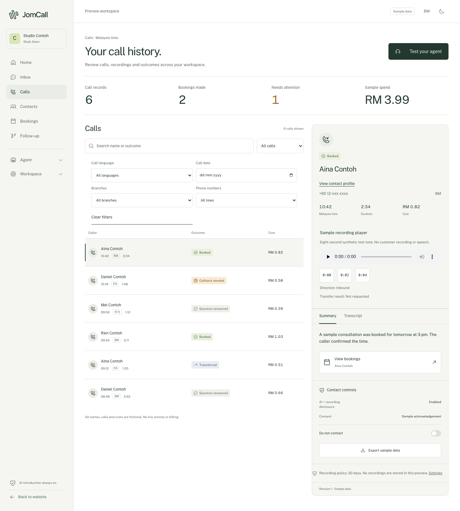
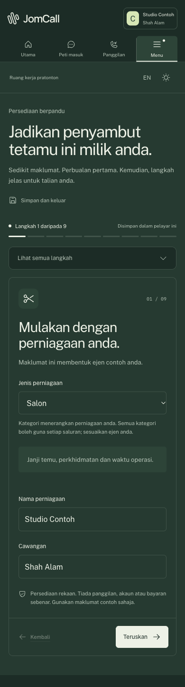

# JomCall

A source-available AI front desk for Malaysian small businesses.

**JomCall** is built to answer a business's phone calls and WhatsApp messages 24/7, in the caller's language: BM, English, Manglish or Mandarin. It answers questions from the business's own information, books appointments, takes messages and hands the conversation to staff. Clinics, salons, workshops, tuition centres and property agents miss calls every day. This is for them.

It will run as a hosted, self-serve service billed in MYR. The full code is public under the [Functional Source License](LICENSE.md): anyone can read it, learn from it, run it for their own business and contribute. Each release becomes Apache-2.0 open source two years after it is published.

> **Status: pre-alpha.** Nothing is connected to real phone lines, WhatsApp, calendars or payments yet. What exists today is a complete clickable preview with fictional data, and a local backend for accounts, contacts, consent and bookings. The AI agent is experimental and has not passed its quality gate. See the [roadmap](ROADMAP.md) for exactly what works and what does not.

*Jom* is what Malaysians say for "let's go". JomCall picks up so your customers never wait.

<p>
  
  
</p>

## Try the preview

The mock preview runs every screen with fictional data saved in your browser. It needs only Node.js 24 and no database, Docker or accounts.

```sh
npm ci
npm run dev:mock
```

Open <http://127.0.0.1:4181>. Click **Explore the app** to reach the dashboard. Switch between BM and English, and light and dark, from the top bar.

All names, numbers, calls and amounts in the preview are fake. Calls, payments and connections are simulations.

## What works today

| Area | Mock preview (port 4181) | Local backend (port 4182) | Not built yet |
|---|---|---|---|
| Sign-up, login, recovery, invites | Simulated | Real local accounts; email goes to a local inbox | Google sign-in, hosted email |
| Workspaces, branches, hours, roles | Yes | Yes, with owner/admin/staff checks | Public holidays from a verified source |
| Agent builder and versions | Yes | Drafts, text knowledge, immutable published versions, restore | Website import, document upload |
| Agent text test | Simulated | Real text sessions with citations and tool traces (experimental model) | Passing the multilingual quality gate |
| Browser test call | Simulated | Not available | Real voice |
| Contacts, consent, do-not-contact | Yes | Yes, with history and audit | — |
| PDPA export and delete | Yes | Durable jobs with retries and expiring downloads | Recordings and connector data (none exist yet) |
| Bookings | Yes | Staff booking, review, confirm, reschedule, cancel; no double booking | Google Calendar and Cal.com sync |
| Call log and recordings | Fictional calls, synthetic test tone | Not available | Real calls, transcripts, summaries |
| Shared inbox (calls + WhatsApp) | Yes | Not available | WhatsApp Cloud API |
| Phone numbers and forwarding | Simulated | Not available | SIP trunk, Malaysian numbers |
| Wallet and billing (MYR) | Simulated payments | Not available | Payment provider, usage settlement |
| Outbound follow-up workflows | Yes | Not available | Lead sources, real sends |
| Hosted admin, self-host checks | Yes | Not available | Real operations |

## Run the local backend

The local backend runs Supabase Auth and Postgres in Docker on your machine. It needs no cloud account, API key or subscription. The first run downloads packages and container images.

**You need:** Node.js 24, Docker Desktop, Supabase CLI **2.98.2**, and at least 10 GiB free disk.

```sh
npm ci
npm run local:check
npm run local:start
npm run db:migrate:local
```

Then run each of these in its own terminal:

```sh
npm run dev:local   # app at http://127.0.0.1:4182
npm run dev:engine  # background jobs: privacy exports/deletions and invitations
```

Sign up in the local app. Open the [local Mailpit inbox](http://127.0.0.1:54624) to confirm your email, then create a workspace. There is no default account and no seeded customer data. All development email, including invitations and recovery links, stays in Mailpit.

To stop: press Ctrl+C in each terminal, then run `npm run local:stop`. Database volumes are kept. Do not use broad Docker volume pruning to stop development; it can delete other projects' data.

More detail: [local operations guide](infra/local/README.md).

### Optional: local AI model

The agent text test can use a pinned model that runs on your machine. It is experimental: on the latest run of the 48-case evaluation it passed 28 cases and recorded no booking proposals. Follow [model preparation](infra/local/README.md#optional-local-text-model), set `JOMCALL_MODEL_PROVIDER=ollama` in both ignored local env files, then:

```sh
npm run model:start
npm run dev:agent
```

### Production builds

```sh
npm run build:mock && npm run start:mock     # port 4181
npm run build:local && npm run start:local   # port 4182
```

Stop the matching dev server first. The two builds use separate output folders, and build and start modes must match.

## Checks

```sh
npm run typecheck
npm run check:phase2          # core, API, database, engine and inference tests
npm run db:verify-migrations  # replays migrations into a fresh scratch database
npm run build:mock
npm run build:local
npm run contracts:generate
```

Tests create fake users and organizations in this project's local database and use separate queue names. Migration replay uses a new scratch database and never resets your workspace. `npm run check:local-model` runs the 48-case model evaluation; it needs the local model running and currently fails by design until the model improves.

## How it is built

| Part | Language | Job |
|---|---|---|
| `web` | Next.js, TypeScript | Website, app screens, REST API, auth callbacks and webhooks |
| `engine` | TypeScript worker | Background jobs: privacy exports and deletions, invitations, agent turns; later post-call work and outbound workflows |
| `voice` *(planned)* | Python, LiveKit Agents | Answers calls over a Malaysian SIP trunk with swappable speech-to-text, language model and text-to-speech |
| Postgres | SQL | All data, with forced row-level security per business. The job queue (pg-boss) also lives here, so self-hosters need no Redis |

```text
web/                 Next.js app: public site, product screens, API routes
engine/              background workers (privacy, mail, agent)
packages/contracts/  validated request and response schemas
packages/domain/     business rules and tenant-scoped commands
packages/db/         database access and transactions
packages/inference/  language model adapters and safety budget
supabase/            SQL migrations, roles and email templates
infra/local/         local service and model configuration
scripts/             local start, stop, migrate and check scripts
tests/               API, database, domain, engine and inference tests
docs/                design spec, plans, research and QA evidence
```

The mock preview and the local app are kept strictly apart. The mock uses fictional browser data. The local app calls named server commands. A local error never falls back to mock data.

## Principles

- **Malaysia first.** BM and English UI. Amounts in MYR, stored as integer sen. Times in `Asia/Kuala_Lumpur`. Phone numbers in E.164. Mobile-first, because owners check calls on their phones.
- **Compliance on screen.** AI and recording disclosure, consent records, a do-not-contact switch, and PDPA export and delete are part of the product, not an afterthought.
- **Never pretend.** The agent does not confirm a booking without a durable record. A sent message is not a delivered one. Usage is billed once, only after the provider confirms it.
- **Your data stays yours.** Every business's data is isolated in the database. Self-hosting is a first-class option.
- **Fake data only in this repo.** No real call audio, transcripts or customer details, ever.

## Documentation

| Document | What it covers |
|---|---|
| [Roadmap](ROADMAP.md) | Every milestone, what is done, what is left and the acceptance gates |
| [Design spec](docs/superpowers/specs/2026-10-15-jomcall-design.md) | Architecture, call and WhatsApp flows, data model, compliance, risks |
| [Backend roadmap](docs/superpowers/plans/2026-10-15-backend-roadmap.md) | How each screen connects to real services |
| [Integration research](docs/research/integration-roadmap.md) | Phone, WhatsApp, calendar and other connectors |
| [Voice research](docs/research/voice-options.md) | Text-to-speech options and techniques for natural Malaysian calls |
| [Screen inventory](docs/frontend/screens.md) | Every frontend screen and its status |
| [Local operations](infra/local/README.md) | Running, stopping and troubleshooting the local backend |
| [M1 QA evidence](docs/qa/2026-10-16-local-core-platform.md) | Core platform verification |
| [M2 QA evidence](docs/qa/2026-10-16-local-agent-booking.md) | Bookings, text agent and model evaluation results |

## Contributing

The project is early, and the best help right now is:

- Running the preview and reporting anything confusing, broken or not Malaysian enough.
- Consented, fake-content Malaysian speech recordings for the speech benchmark.
- Confirmed call-forwarding behaviour on Malaysian telcos.
- Natural BM copy.

Use Conventional Commits and work on a feature branch. Only use clearly fake sample data. Never commit keys, tokens or `.env` files. A full contributing guide is on the [roadmap](ROADMAP.md#r--open-source-and-build-in-public-track).

## License

[FSL-1.1-ALv2](LICENSE.md) (Functional Source License, Apache 2.0 future licence). This is "fair source", not OSI open source.

- **You can:** read, copy and modify the code; run it for your own business, including commercially; use it for non-commercial education and research; offer professional services to someone using it; and contribute back.
- **You can't:** offer it, or a product with substantially the same functionality, as a competing commercial product or service.
- **Two years after each release**, that release is also available under the Apache License 2.0, with no restrictions on competing use.

An earlier version of this repository was briefly published under AGPL-3.0 on 22 October 2026. Copies of that version keep their AGPL-3.0 grant; everything published since is FSL-1.1-ALv2.

"JomCall" and its logo are not covered by the licence. Don't use them for a fork or another product.
